<div align="center">

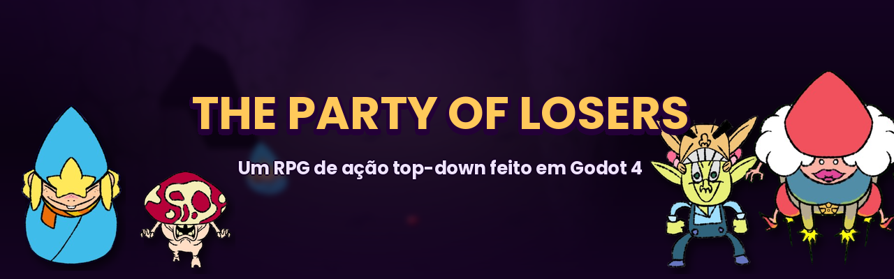

<br>


*Era uma vez, em um reino distante...*

</div>

---

## 📜 Sobre o jogo

**The Party Of Losers** é um RPG de ação com visão de cima, feito na Godot 4 com personagens desenhados à mão.

Um rei está aflito: sua filha, a princesa, está terrivelmente doente. Cabe a um pequeno mago de capa azul atravessar uma dungeon cheia de cogumelos mal-humorados, ajudar (ou não) um pedinte suspeito e enfrentar a **inocente, delicada e charmosa MissEile**.

<div align="center">
  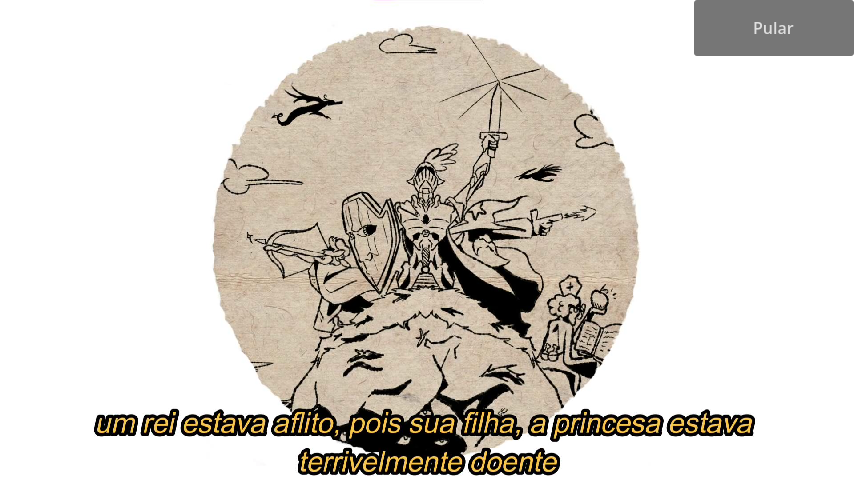
  <br><sub>A história começa com uma cinemática desenhada à mão.</sub>
</div>

---

## 🖼️ Screenshots

<table>
  <tr>
    <td width="50%">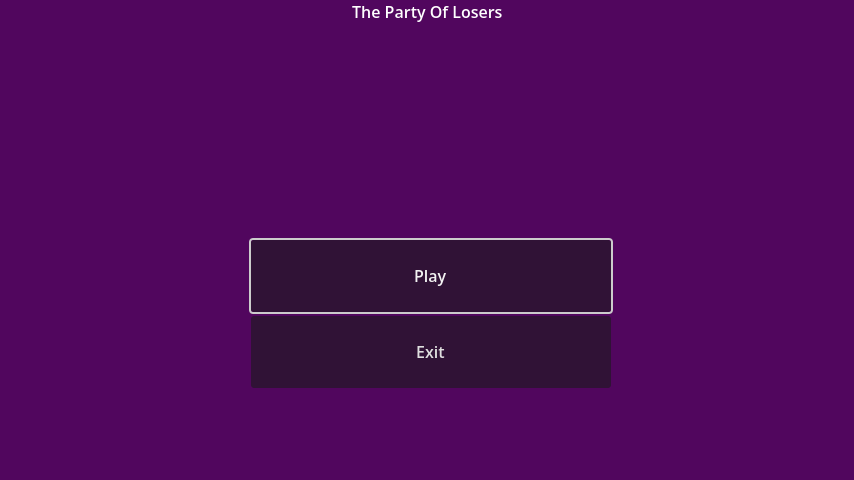</td>
    <td width="50%">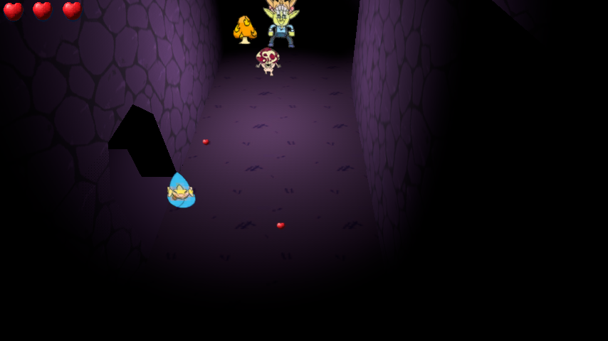</td>
  </tr>
  <tr>
    <td align="center"><sub><b>Menu principal</b></sub></td>
    <td align="center"><sub><b>A dungeon</b>: corredores escuros de pedra roxa</sub></td>
  </tr>
  <tr>
    <td>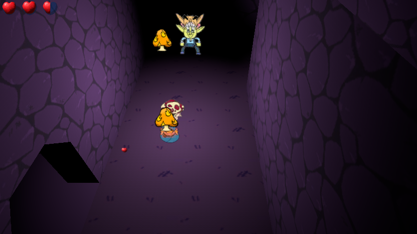</td>
    <td>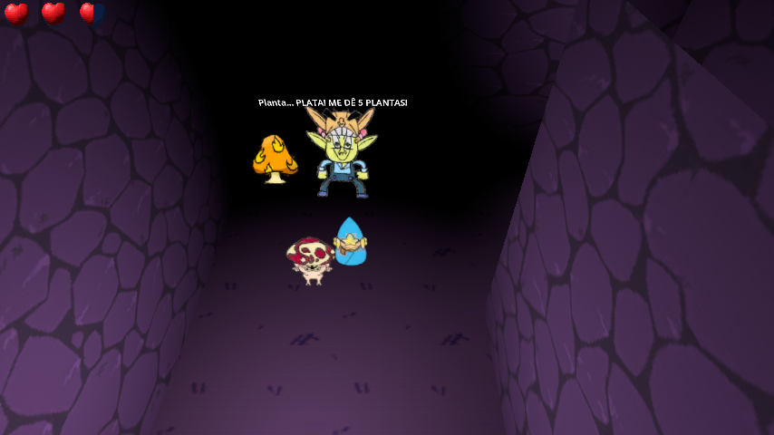</td>
  </tr>
  <tr>
    <td align="center"><sub><b>Combate</b>: o mago carregando um cogumelo explosivo</sub></td>
    <td align="center"><sub><b>O Pedinte</b>: "Planta... PLATA! ME DÊ 5 PLANTAS!"</sub></td>
  </tr>
  <tr>
    <td>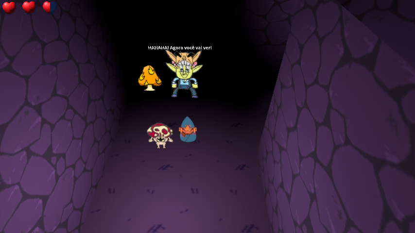</td>
    <td>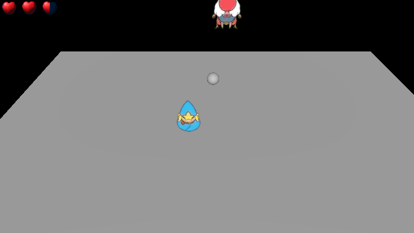</td>
  </tr>
  <tr>
    <td align="center"><sub>Entregue as plantas e descubra quem ele é de verdade...</sub></td>
    <td align="center"><sub><b>MissEile</b>: a chefe da dungeon</sub></td>
  </tr>
  <tr>
    <td>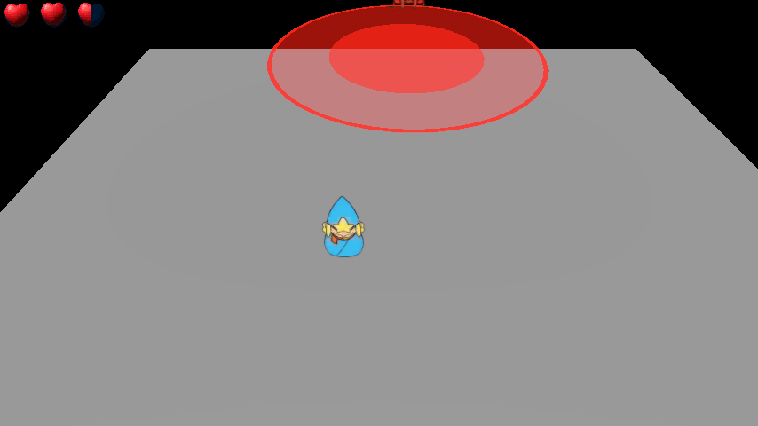</td>
    <td>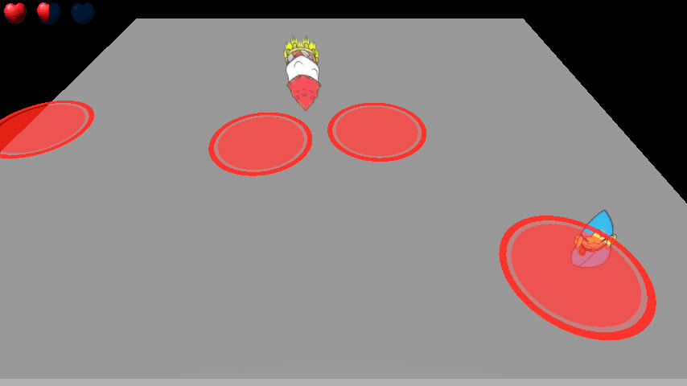</td>
  </tr>
  <tr>
    <td align="center"><sub>O chão avisa onde a explosão vai acontecer: <b>corra!</b></sub></td>
    <td align="center"><sub>Chuva de mísseis nas áreas longe dela</sub></td>
  </tr>
</table>

---

## 🎮 Como jogar

| Ação | Controle |
|---|---|
| Andar | **W A S D** ou **setas** |
| Atirar (na direção do mouse) | **Botão esquerdo do mouse** |
| Pegar o cogumelo explosivo | Encoste nele |
| Arremessar o cogumelo | **Botão esquerdo do mouse** (com o cogumelo na mão) |
| Falar / interagir / coletar | **E** |

Você tem **3 corações**. A vida é mantida quando você troca de área, então cuidado antes de entrar na sala da chefe!

---

## ✨ O que tem no jogo

- 🧙 **Mago com tiro mágico**: atira na direção do mouse e leva um empurrão (knockback) ao tomar dano.
- 🍄 **Cogumelo explosivo**: pegue no mapa e arremesse. A explosão machuca todos os inimigos por perto e também derruba a **torre de vigia**, que vira uma ponte.
- 🌿 **Missão do Pedinte**: encontre as 5 plantas espalhadas pela dungeon e entregue para ele. Ele não é tão inofensivo quanto parece.
- 🎬 **Cinemática** de abertura legendada (dá para pular).
- 🎥 **Câmera inteligente**: segue o mago com um leve atraso, não mostra o que está fora do mapa e abre um "buraco" nas paredes que ficam entre ela e o player.
- ⭐ **Transição em estrela**, no estilo dos clássicos do Nintendo 64.
- 🕹️ **Mini game alternativo**: quer pular a chefe? Dá para jogar um mini game no lugar, mas você ganha menos experiência.

### 👑 A luta contra a MissEile

A chefe tem um ciclo de ataques:

1. **Tiros**: parada no lugar dela, atira rajadas quando você chega perto.
2. **Explosão**: um círculo vermelho aparece no chão em volta dela. Saia antes que ele se encha!
3. **Perseguição**: ela se transforma e voa atrás de você. É a melhor hora para contra-atacar.
4. **Chuva de mísseis**: quando ela volta para o lugar, bolas caem do céu nas áreas mais longe dela (com aviso no chão), obrigando você a se aproximar de novo.

<div align="center">
  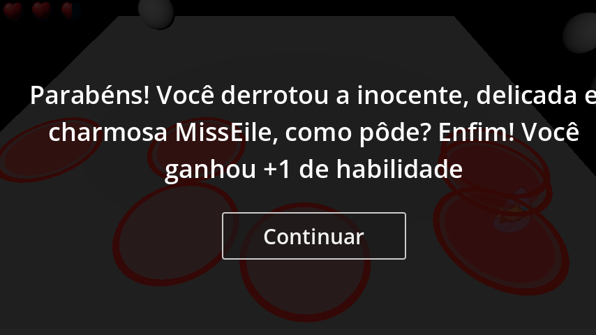
</div>

---

## 🚀 Como rodar o projeto

**Requisitos:** [Godot Engine 4.7](https://godotengine.org/download) ou mais nova (versão padrão, não a .NET).

1. Clone o repositório:
   ```bash
   git clone https://github.com/gusrezende/ThePartyOfLosersGodotVer.git
   ```
2. Abra a Godot e, no Gerenciador de Projetos, clique em **Importar**.
3. Selecione o arquivo `project.godot` dentro da pasta clonada.
4. Aperte **F5** para jogar.

> Na primeira vez a Godot demora um pouco para importar todas as imagens. É normal.

---

## 🗂️ Estrutura do projeto

```
ThePartyOfLosersGodotVer/
├── Cenários/        # Fases: Dungeon1 e a arena da MissEile
├── Personagens/     # Player (mago), inimigos, MissEile e o Pedinte
├── Mecânicas/       # Projéteis, cogumelo explosivo, coletáveis, torre-ponte, estado do jogo
├── Mini games/      # Mini game alternativo à luta contra a chefe
└── UI/              # Menu, cinemática, corações de vida e transição de tela
```

---

## 🛠️ Feito com

- [Godot Engine 4.7](https://godotengine.org/) com renderizador **Forward+** e física **Jolt**
- **GDScript**
- Arte e animações desenhadas à mão pela equipe

---

## 📄 Licença

Este projeto está sob a licença **MIT**. Veja o arquivo [LICENSE](LICENSE) para mais detalhes.

<div align="center">
<br>
<sub>Feito com 💜 (e muitos cogumelos) pela equipe <b>The Party Of Losers</b></sub>
</div>
